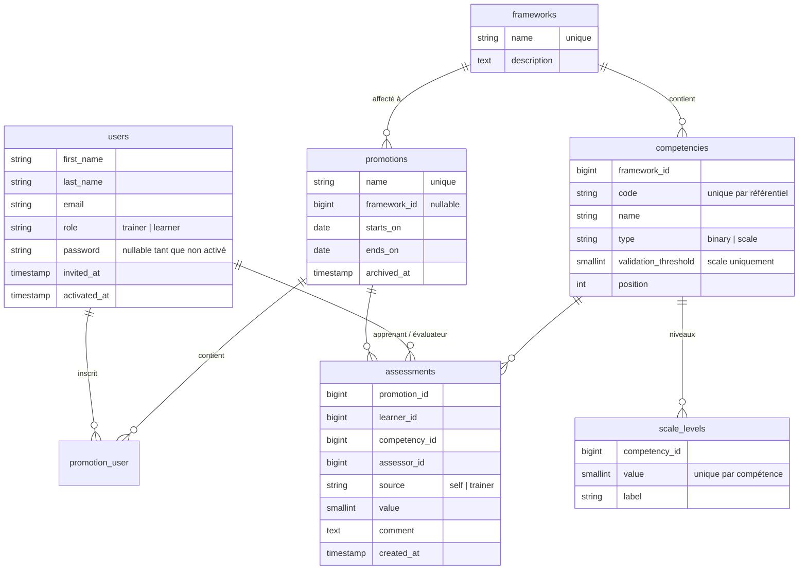

# Architecture

## Stack

| Couche        | Technologie                                                                                     |
| ------------- | ----------------------------------------------------------------------------------------------- |
| Backend       | Laravel 13, PHP 8.4+ ; authentification Fortify (connexion, mot de passe oublié, 2FA, passkeys) |
| Front         | Inertia 3 + Svelte 5 (runes) + TypeScript, Tailwind 4, composants shadcn-svelte                 |
| Routes typées | Laravel Wayfinder : `resources/js/actions` et `resources/js/routes`, générés (non versionnés)   |
| Base          | SQLite en local et en tests, MySQL 8 prévu en production                                        |
| File          | Driver `database` : les emails d'invitation partent en file d'attente                           |
| Tests         | Pest 5 (tests de fonctionnalité sur base SQLite en mémoire)                                     |

L'application suit le starter kit Svelte officiel : les contrôleurs renvoient des pages Inertia (`Inertia::render('dossier/Page', [...props])`) qui correspondent à `resources/js/pages/dossier/Page.svelte`.

## Modèle de données



Points clés :

- **`users.name`** n'existe plus en base : c'est un attribut calculé (`Prénom Nom`), ajouté à la sérialisation pour les composants du kit.
- **`role`** n'est pas assignable en masse ; il se fixe explicitement (commande `lms:create-trainer`, factory).
- **`assessments`** est en ajout seul : chaque autoévaluation ou validation crée une ligne. L'état courant est la ligne la plus récente par (apprenant, compétence, source). Les évaluations sont rattachées à la promotion : un apprenant inscrit dans deux promotions a deux historiques distincts.
- Clés étrangères : supprimer une compétence évaluée est bloqué en base (`restrictOnDelete`), tout comme supprimer un référentiel affecté à une promotion.

## Règles métier

| Règle                                              | Où                                                                          |
| -------------------------------------------------- | --------------------------------------------------------------------------- |
| Valeurs admises d'une compétence                   | `Competency::acceptsValue()` / `allowedValues()`                            |
| Compétence acquise                                 | `Competency::isAcquiredWith()` — validation formateur seulement             |
| Écart / à examiner                                 | `App\Support\CompetencyCell`                                                |
| Inscription d'un apprenant                         | `App\Actions\Learners\EnrollLearner`                                        |
| Import CSV                                         | `App\Actions\Learners\ImportLearners`                                       |
| Création / modification d'une compétence           | `App\Actions\Frameworks\SaveCompetency`                                     |
| Import JSON                                        | `App\Actions\Frameworks\ImportFramework`                                    |
| Validation d'une compétence (formulaire et import) | `App\Validation\CompetencyRules`                                            |
| Enregistrement d'une évaluation                    | `App\Actions\Assessments\RecordAssessment`                                  |
| Progression                                        | `App\Queries\PromotionProgress`, `LearnerCompetencies`, `LatestAssessments` |
| Badges : règles et attribution                     | `App\Enums\Badge`, `App\Actions\Progress\SyncBadges`                        |
| Nouveaux badges et compétences à fêter             | `App\Actions\Progress\PullNewBadges`, `PullCelebrations`                    |
| Fil d'activité de l'apprenant                      | `App\Queries\LearnerActivity`                                               |

Détail des définitions :

- **Acquise** : binaire → dernière validation = 1 ; échelle → dernière validation ≥ `validation_threshold`.
- **À examiner** : une autoévaluation existe et elle est plus récente que la dernière validation (ou il n'y a pas de validation).
- **Écart** : autoévaluation et validation existent et diffèrent.
- **Progression** : compétences acquises / compétences du référentiel, arrondi à l'entier ; moyenne simple des apprenants pour une promotion.

Verrous :

- promotion archivée → plus d'inscription ni d'évaluation ;
- compétence évaluée → type et valeurs de niveaux figés, suppression interdite ;
- promotion évaluée → référentiel figé ;
- référentiel affecté → suppression interdite.

## Sécurité et accès

| Mécanisme            | Rôle                                                                                                                              |
| -------------------- | --------------------------------------------------------------------------------------------------------------------------------- |
| Inscription publique | Désactivée (`Features::registration()` commenté dans `config/fortify.php`)                                                        |
| Middleware `trainer` | `EnsureUserIsTrainer` : 403 pour tout autre utilisateur                                                                           |
| Middleware `learner` | `EnsureUserIsLearner` : 403 pour tout autre utilisateur                                                                           |
| Liens d'invitation   | URL signée temporaire (7 jours), routes `guest` + `signed`, usage unique (refus si activé), limitée à 6 essais/min                |
| Appartenance         | Les contrôleurs vérifient qu'un apprenant appartient à la promotion (404 sinon) et qu'une compétence appartient à son référentiel |
| Compte non activé    | Mot de passe `null` : connexion impossible                                                                                        |

## Routes métier

| Accès        | Routes                                                                                                |
| ------------ | ----------------------------------------------------------------------------------------------------- |
| Tous         | `GET /dashboard` (accueil formateur ou apprenant selon le rôle)                                       |
| Formateur    | `promotions.*` (CRUD sans suppression, `archive`, `unarchive`, `progress` = `/promotions/{id}/suivi`) |
| Formateur    | `promotions.learners.store / import / destroy / show`, `promotions.learners.assessments.store`        |
| Formateur    | `learners.invitation.resend`                                                                          |
| Formateur    | `frameworks.*`, `frameworks.import`, `frameworks.competencies.*` (liaisons imbriquées)                |
| Apprenant    | `my-competencies.index` (`/mes-competences`), `my-competencies.store`                                 |
| Invité signé | `invitation.show`, `invitation.accept` (`/invitation/{user}`)                                         |

Liste complète : `php artisan route:list --except-vendor`.

## Organisation du code

```
app/
├── Actions/          # opérations métier (Learners, Frameworks, Assessments)
├── Console/Commands/ # lms:create-trainer
├── Enums/            # Role, CompetencyType, AssessmentSource
├── Http/
│   ├── Controllers/  # contrôleurs fins : validation → action → redirection / page
│   ├── Middleware/   # trainer, learner
│   └── Requests/     # FormRequest (promotion, référentiel, compétence, apprenant)
├── Models/           # User, Promotion, Framework, Competency, ScaleLevel, Assessment
├── Notifications/    # LearnerInvitation (email, en file d'attente)
├── Queries/          # lectures complexes (progression, dernières évaluations)
├── Support/          # CompetencyCell
└── Validation/       # CompetencyRules (partagé formulaire / import JSON)

resources/js/
├── pages/            # une page Svelte par écran (promotions/, frameworks/, learner/, trainer/…)
├── components/       # composants métier (promotions/, learners/, frameworks/, assessments/, progress/)
│   └── ui/           # composants shadcn-svelte du kit
├── lib/              # utilitaires (dates FR, libellés de compétences, classes de champs)
└── types/            # types TypeScript des props
```

Conventions :

- les messages d'erreur métier sont levés comme `ValidationException` pour s'afficher dans les formulaires Inertia ;
- les notifications de succès passent par `Inertia::flash('toast', …)` ;
- le front est mobile first : cartes sur mobile, grilles ou tableaux à partir de `md`/`lg`, zones tactiles de 44 px (`h-11`) ramenées à 36 px (`sm:h-9`) sur grand écran.
